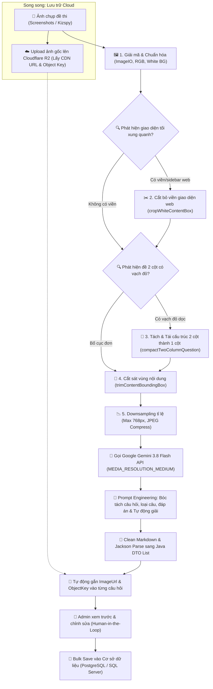

# 🎓 FUExam - Hệ Thống Luyện Thi & Số Hóa Ngân Hàng Đề Thi Trắc Nghiệm Thông Minh

[](https://www.oracle.com/java/)
[](https://spring.io/projects/spring-boot)
[](https://ai.google.dev/)
[](https://www.cloudflare.com/products/r2/)
[](https://www.docker.com/)
[](https://www.postgresql.org/)

---

## 📖 1. Giới Thiệu Dự Án

**FUExam** là nền tảng quản lý đề thi và luyện thi trắc nghiệm trực tuyến được thiết kế chuyên biệt cho sinh viên Đại học FPT (hỗ trợ định dạng đề thi đặc trưng như Kizspy, đề thi trắc nghiệm FPTU).

Dự án giải quyết bài toán lớn nhất trong việc xây dựng ngân hàng câu hỏi: **Tốn quá nhiều thời gian và công sức nhập liệu thủ công từ tài liệu hoặc ảnh chụp màn hình**. Bằng cách kết hợp **Computer Vision (Xử lý ảnh bằng Java AWT/ImageIO)** và **Mô hình ngôn ngữ thị giác đa phương thức (Multimodal Vision AI - Google Gemini 3.8 Flash)**, FUExam mang đến khả năng số hóa hàng loạt đề thi từ ảnh chụp màn hình với độ chính xác cao, tự động nhận diện dạng câu hỏi, bóc tách phương án lựa chọn và tự động giải/gợi ý đáp án chính xác.

---

## ✨ 2. Tính Năng Nổi Bật

### 👨‍💼 Dành Cho Quản Trị Viên (Admin)
- **Số hóa đề thi tự động bằng AI OCR**: Upload một hoặc nhiều ảnh chụp đề thi cùng lúc; hệ thống tự động bóc tách chữ, nhận diện câu hỏi, cấu trúc lại câu trả lời và tự động giải đề.
- **Quy trình kiểm duyệt Human-in-the-Loop**: Kết quả trích xuất được trả về cho Admin xem lại, chỉnh sửa nội dung/đáp án trước khi lưu hàng loạt (*Bulk Insert*) vào cơ sở dữ liệu.
- **Quản lý Đề thi & Môn học**: Tạo môn học, cấu hình bộ đề, ẩn/hiện đề thi (`PUBLISHED` / `HIDDEN` / `REVIEW`).
- **Quản lý Câu hỏi & Media**: Chỉnh sửa câu hỏi, bổ sung/thay thế ảnh minh họa (lưu trữ trên Cloudflare R2).
- **Quản lý Người dùng**: Phân quyền tài khoản (`ADMIN`, `USER`), khóa/mở tài khoản người dùng.

### 🧑‍🎓 Dành Cho Sinh Viên (User)
- **Luyện thi tương tác (Interactive Practice)**:
  - Làm bài thi theo từng đề môn học.
  - Chế độ kiểm tra đáp án tức thì (*Instant Feedback*) cho từng câu hỏi hoặc nộp bài toàn bộ.
- **Xem lại & Đánh giá kết quả (Review & Analysis)**:
  - Chấm điểm tự động và thống kê số câu đúng/sai.
  - Xem lại toàn bộ lịch sử thi (*Exam Attempts*) kèm đáp án chi tiết và giải thích.
- **Đăng nhập linh hoạt**: Hỗ trợ đăng nhập truyền thống (Username/Password) và Đăng nhập một chạm bằng **Google OAuth2**.

---

## 🧠 3. Chuyên Sâu: Kiến Trúc & Quy Trình AI OCR (Core Pipeline)

Khâu **OCR (Optical Character Recognition)** là trái tim của dự án. Không sử dụng các thư viện OCR thuần text truyền thống (như Tesseract) vốn gặp nhiều hạn chế khi đọc ảnh chụp màn hình độ phân giải thấp, bảng biểu hoặc công thức, FUExam kết hợp **Pipeline tiền xử lý hình ảnh độc quyền bằng Java Computer Vision** cùng **Mô hình AI Thị giác Đa phương thức (Multimodal Vision AI) của Google**.

### 🔄 Sơ Đồ Quy Trình Hoạt Động (End-to-End Workflow)



---

### 🔬 3.1. Pipeline Tiền Xử Lý Ảnh (Pre-processing Engine)

Tại `OcrServiceImpl`, thuật toán xử lý ảnh thuần Java (`java.awt`, `javax.imageio`) được thiết kế riêng để tối ưu hóa ảnh chụp từ các công cụ thi (Kizspy, FPT Exam viewer):

#### 1. Nhận diện & Cắt bỏ viền giao diện tối (`isScreenshotWithDarkSidebar` & `cropWhiteContentBox`)
- **Vấn đề**: Ảnh chụp màn hình thường chứa viền đen của hệ điều hành, trình duyệt web, thanh bình luận sidebar bên phải hoặc danh sách ảnh thu nhỏ bên dưới.
- **Giải pháp**:
  - Tính toán độ sáng tương đối theo công thức:
    $$\text{Luminance} = 0.299 \times R + 0.587 \times G + 0.114 \times B$$
  - Quét kiểm tra khu vực rìa phải ($x = 92\% \text{ width}$) để phát hiện sidebar tối ($\text{Luminance} < 100$).
  - Thuật toán `cropWhiteContentBox` phân tích phổ pixel sáng ($\text{Luminance} \ge 200$) trên từng hàng và cột, tự động định vị khung bao chính xác của thẻ câu hỏi màu trắng (*White Card*).
  - Tích hợp cơ chế thông minh (*Margin check*): Bảo toàn các khối mã nguồn giao diện tối (*Dark Code Blocks*) hoặc hình vẽ nằm bên trong câu hỏi mà không làm cắt xén nhầm.

#### 2. Tái cấu trúc đề thi 2 cột có vạch đỏ (`findVerticalRedDivider` & `compactTwoColumnQuestion`)
- **Vấn đề**: Bố cục đề thi chuẩn Kizspy chia làm 2 cột ngăn cách bởi một đường kẻ đỏ dọc mảnh:
  - *Cột trái*: Chứa số câu hỏi (`Question: 27`), quy định số lượng đáp án (`(Choose 2 answers)`), và logo bản quyền FUO ở góc dưới.
  - *Cột phải*: Chứa nội dung đề bài và các lựa chọn đáp án A, B, C, D...
  - Bố cục 2 cột nằm ngang chiếm nhiều diện tích, dễ khiến AI đọc nhầm dòng hoặc bỏ sót chỉ dẫn số lượng câu trả lời.
- **Giải pháp**:
  - Thuật toán dò tìm đường vạch đỏ dọc (`isRedDividerPixel`):
    $$R > 140 \quad \text{và} \quad (R - G) > 60 \quad \text{và} \quad (R - B) > 60$$
    chạy xuyên suốt trên $75\%$ chiều cao ảnh.
  - Tách ảnh thành 2 phần độc lập:
    - `extractLeftHeader`: Cắt lấy góc trên bên trái chứa số câu và chú thích `(Choose X answer)`, tự động cắt bỏ logo FUO và khoảng trắng rỗng bên dưới.
    - `rightRaw`: Lấy toàn bộ nội dung câu hỏi và các đáp án.
  - Sử dụng `Graphics2D` ghép chồng (*Stacking*) phần chú thích lên trên, kẻ một đường phân cách mảnh, và đặt nội dung câu hỏi ở dưới -> **Chuyển đổi bố cục 2 cột cồng kềnh thành bố cục 1 cột dọc nhỏ gọn**.

#### 3. Cắt sát vùng nội dung (`trimContentBoundingBox`)
- Thuật toán tự động tìm đường biên nội dung thực tế (chữ màu tối có $\text{Luminance} < 180$, hoặc các nét vẽ có màu sắc với $\text{Saturation} > 20$).
- Loại bỏ các thành phần rác như nút điều hướng mũi tên xám nhạt (`<`, `>`), watermark mờ và khoảng trắng dư thừa.
- Bổ sung padding an toàn giúp ảnh không bị cụt mép chữ.

#### 4. Chuẩn hóa & Giảm thiểu Token tiêu thụ (`resizeAndCompress`)
- Downsample ảnh về kích thước tối đa `maxDim = 768px` bằng thuật toán nội suy song tuyến tính (`VALUE_INTERPOLATION_BILINEAR`).
- Chuyển toàn bộ ảnh sang `BufferedImage.TYPE_INT_RGB` nền trắng tinh (xử lý triệt để lỗi kênh trong suốt Alpha khi chuyển PNG sang JPEG).
- **Tối ưu chi phí AI**:
  - Ảnh $\le 384 \times 384\text{ px}$: Chỉ tốn $\approx 258$ Gemini tokens.
  - Ảnh $\le 768 \times 768\text{ px}$: Chỉ tốn $\approx 1032$ Gemini tokens.
  - Giảm đến **$60\% - 75\%$ lượng token tiêu thụ** so với việc gửi ảnh chụp màn hình gốc ($1920 \times 1080$).

---

### 🤖 3.2. Mô Hình AI OCR & Trích Xuất Cấu Trúc

Sau khi ảnh được tối ưu, hệ thống chuyển sang giai đoạn suy luận đa phương thức:

#### Mô hình sử dụng: Google Gemini 3.8 Flash
- **API Endpoint**: `https://api.apiz.vn/v1beta/models/gemini-3.8-flash:generateContent` (tương thích Google Gemini REST API).
- **Cấu hình độ phân giải**:
  ```json
  "generationConfig": {
    "mediaResolution": "MEDIA_RESOLUTION_MEDIUM"
  }
  ```
  Giúp nhận diện rõ nét từng ký tự, code snippet và sơ đồ trong khi vẫn tối ưu tốc độ phản hồi và hạn mức API.

#### Prompt Engineering & AI Auto-Solving
Hệ thống sử dụng kỹ thuật Few-shot/Structured Prompting nghiêm ngặt:
- **Nhận diện loại câu hỏi tự động**: Dựa trên chỉ dẫn trên ảnh (ví dụ: `Choose 1 answer` $\rightarrow$ `SINGLE_CHOICE`, `Choose 2/3 answers` $\rightarrow$ `MULTIPLE_CHOICE`).
- **AI Tự động giải đề (Auto-Solving)**: Gemini không chỉ đọc chữ (OCR thuần túy) mà còn dùng năng lực lý luận của mô hình ngôn ngữ lớn để **suy luận và đánh dấu sẵn đáp án chính xác** (`correct: true`), giúp tiết kiệm $90\%$ công sức rà soát đáp án của giáo viên/quản trị viên.
- **Ràng buộc đầu ra (Strict JSON Enforcement)**: Bắt buộc mô hình trả về đúng định dạng JSON Array tương thích hoàn toàn với Java DTO:
  ```json
  [
    {
      "questionNumber": 1,
      "content": "The Standard Dialect in Thymeleaf provides a set of:",
      "questionType": "SINGLE_CHOICE",
      "answerOption": [
        { "optionLabel": "A", "content": "Database drivers.", "correct": false },
        { "optionLabel": "B", "content": "HTML attributes and elements.", "correct": true },
        { "optionLabel": "C", "security protocols.", "correct": false },
        { "optionLabel": "D", "Network configurations.", "correct": false }
      ]
    }
  ]
  ```

#### Xử lý Hậu kỳ (Post-processing)
- Bóc tách nội dung từ cấu trúc JSON phản hồi của Google: `candidates[0].content.parts[0].text`.
- Tự động làm sạch các thẻ bao bọc Markdown (```json ... ```).
- Sử dụng Jackson `ObjectMapper` parse trực tiếp thành `List<QuestionRequest>`.
- Tự động liên kết `imageUrl` và `objectKey` từ Cloudflare R2 vào đối tượng câu hỏi trước khi gửi về cho client.

---

## 🛠️ 4. Danh Sách Công Nghệ Sử Dụng

### 💻 Backend & Core Frameworks
| Công nghệ | Phiên bản | Vai trò trong hệ thống |
| :--- | :--- | :--- |
| **Java** | 21 (LTS) | Ngôn ngữ phát triển chính, tận dụng Virtual Threads và tính năng hiện đại |
| **Spring Boot** | 3.x / 4.x Starter | Framework xây dựng ứng dụng Web RESTful API |
| **Spring Security** | 6.x | Phân quyền bảo mật hệ thống theo vai trò (`ADMIN`, `USER`) |
| **Spring Data JPA & Hibernate** | Latest | Quản lý tầng dữ liệu, ORM, truy vấn động với `JpaSpecificationExecutor` |
| **Lombok** | Latest | Tối giản boilerplate code (Getter, Setter, Builder, Logging) |
| **Spring Validation** | Latest | Xác thực dữ liệu đầu vào (DTO Validation) |

### 🧠 Trí Tuệ Nhân Tạo & OCR (AI & Vision)
| Công nghệ | Vai trò |
| :--- | :--- |
| **Google Gemini 3.8 Flash** | Mô hình AI Multimodal Vision đảm nhận việc đọc ảnh, bóc tách cấu trúc đề thi và tự động giải câu trắc nghiệm |
| **Google Gemini Vision API** | Giao diện REST API kết nối trực tiếp qua `java.net.http.HttpClient` với Base64 inline payload |
| **Java AWT & ImageIO** | Pipeline Computer Vision tiền xử lý ảnh: cắt viền, ghép 2 cột, khử nền, nén tối ưu token |
| **Jackson Core & Databind** | Xử lý, bóc tách và ánh xạ cấu trúc JSON giữa Gemini API và Java Object |

### 🗄️ Cơ Sở Dữ Liệu & Lưu Trữ Đám Mây
| Công nghệ | Vai trò |
| :--- | :--- |
| **PostgreSQL (Neon Cloud)** | Cơ sở dữ liệu quan hệ cho môi trường Production (serverless, nhanh, độ trễ thấp) |
| **Microsoft SQL Server** | Cơ sở dữ liệu quan hệ cho môi trường phát triển Local / Development |
| **HikariCP** | Connection Pool hiệu năng cao, tối ưu hóa cho môi trường tài nguyên giới hạn (512MB RAM) |
| **Cloudflare R2** | Cloud Object Storage chuẩn S3 tương thích, lưu trữ ảnh đề thi và câu hỏi với chi phí băng thông 0đ |
| **AWS SDK for Java v2 (S3)** | Thư viện Java tương tác trực tiếp với Cloudflare R2 bucket thông qua S3 Protocol |

### 🔐 Bảo Mật & Xác Thực (Security & Auth)
| Công nghệ | Vai trò |
| :--- | :--- |
| **JSON Web Token (JJWT 0.12.6)** | Xác thực không trạng thái (Stateless Authentication) với cặp Access Token & Refresh Token |
| **OAuth2 Client** | Tích hợp xác thực Single Sign-On (SSO) qua Google Login |
| **BCrypt Password Encoder** | Mã hóa băm mật khẩu người dùng an toàn |

### 🚀 DevOps, Tài Liệu & Triển Khai
| Công nghệ | Vai trò |
| :--- | :--- |
| **Docker** | Multi-stage build (Temurin 21 JDK -> JRE Jammy tối ưu AWT) đóng gói container |
| **Springdoc OpenAPI / Swagger UI** | Sinh tài liệu tương tác và kiểm thử API trực tiếp tại `/api-docs` |
| **JUnit 5 & Spring Boot Test** | Bộ kiểm thử tự động, kiểm thử tính toàn vẹn của thuật toán xử lý ảnh OCR |

---

## 📂 5. Cấu Trúc Thư Mục Dự Án

```
FUExam/
├── .env.example                                # File mẫu biến môi trường
├── Dockerfile                                   # Cấu hình đóng gói container Docker đa tầng
├── pom.xml                                      # Quản lý dependencies Maven
└── src/
    ├── main/
    │   ├── java/com/se196693/mvc/
    │   │   ├── config/                          # Cấu hình hệ thống (R2, Security, OpenAPI, DB)
    │   │   │   ├── DataInitializer.java         # Tạo tài khoản mặc định (Admin/User) ở Dev
    │   │   │   ├── OpenApiConfig.java           # Cấu hình Swagger / OpenAPI 3.0
    │   │   │   ├── PasswordConfig.java          # Cấu hình BCryptPasswordEncoder
    │   │   │   ├── R2Config.java                # Cấu hình S3Client kết nối Cloudflare R2
    │   │   │   └── SecurityConfig.java          # Chuỗi lọc bảo mật Spring Security & CORS
    │   │   ├── controller/                      # REST API Endpoints
    │   │   │   ├── admin/                       # Các API dành riêng cho Quản trị viên
    │   │   │   │   ├── AdminExamController.java # Quản lý đề thi, upload OCR, bulk save
    │   │   │   │   ├── AdminQuestionController.java # Chỉnh sửa, upload ảnh câu hỏi
    │   │   │   │   ├── AdminSubjectController.java  # Quản lý danh mục môn học
    │   │   │   │   └── AdminUserController.java     # Quản lý danh sách tài khoản
    │   │   │   ├── auth/                        # Các API xác thực (Login, Register, Refresh Token)
    │   │   │   │   └── AuthController.java
    │   │   │   └── user/                        # Các API dành cho Sinh viên luyện đề
    │   │   │       ├── PracticeController.java  # Bắt đầu thi, nộp bài, chấm điểm, review
    │   │   │       ├── QuestionController.java  # Lấy câu hỏi, kiểm tra đáp án
    │   │   │       └── UserController.java      # Quản lý thông tin cá nhân
    │   │   ├── dto/                             # Data Transfer Objects (Request / Response)
    │   │   ├── entity/                          # JPA Entities
    │   │   │   ├── AnswerOption.java            # Lựa chọn đáp án (A, B, C, D)
    │   │   │   ├── Exam.java                    # Đề thi
    │   │   │   ├── ExamAttempt.java             # Lượt thi của sinh viên
    │   │   │   ├── Question.java                # Câu hỏi
    │   │   │   ├── RefreshToken.java            # Lưu trữ refresh token
    │   │   │   ├── Subject.java                 # Môn học
    │   │   │   ├── User.java                    # Người dùng
    │   │   │   └── UserAnswer.java              # Câu trả lời của sinh viên trong lượt thi
    │   │   ├── enums/                           # Định nghĩa Enum (Role, ExamStatus, QuestionType...)
    │   │   ├── exception/                       # Xử lý lỗi toàn cục (Global Exception Handler)
    │   │   ├── repository/                      # Spring Data JPA Repositories
    │   │   ├── security/                        # Bộ lọc JWT & OAuth2 Handler
    │   │   ├── service/                         # Service Interfaces & Implementations
    │   │   │   ├── impl/
    │   │   │   │   ├── AuthServiceImpl.java
    │   │   │   │   ├── ExamServiceImpl.java     # Điều phối upload ảnh R2 & gọi OCR
    │   │   │   │   ├── OcrServiceImpl.java      # Pipeline xử lý ảnh Java AWT & Gemini OCR
    │   │   │   │   ├── PracticeServiceImpl.java # Xử lý logic làm bài thi và tính điểm
    │   │   │   │   ├── QuestionServiceImpl.java # Quản lý & lưu bulk câu hỏi
    │   │   │   │   └── R2StorageServiceImpl.java# Tương tác upload Cloudflare R2
    │   │   └── utils/                           # Tiện ích bổ trợ (FileUtils...)
    │   └── resources/
    │       ├── application.properties           # Cấu hình mặc định (Local - SQL Server)
    │       └── application-prod.properties      # Cấu hình Production (Neon PostgreSQL & Hikari)
    └── test/                                    # Bộ Unit Test & Integration Test
        └── java/com/se196693/mvc/service/impl/
            └── OcrServiceImplTest.java          # Bộ test chuyên sâu các case xử lý ảnh OCR
```

---

## 🌐 6. Tổng Quan Các API Chính

| Nhóm | Phương thức | Endpoint | Mô tả | Quyền hạn |
| :--- | :--- | :--- | :--- | :--- |
| **Auth** | `POST` | `/api/auth/login` | Đăng nhập bằng tài khoản nội bộ | Public |
| **Auth** | `POST` | `/api/auth/register` | Đăng ký tài khoản người dùng mới | Public |
| **Auth** | `POST` | `/api/auth/refresh-token`| Gia hạn Access Token qua Refresh Token | Public |
| **Auth** | `POST` | `/api/auth/logout` | Đăng xuất và thu hồi Refresh Token | Public |
| **OAuth2**| `GET` | `/oauth2/authorization/google` | Khởi động đăng nhập Google | Public |
| **Admin OCR** | `POST` | `/api/admin/exams/{examId}/extract-ocr` | **Upload ảnh đề thi, tiền xử lý & gọi Gemini OCR** | `ROLE_ADMIN` |
| **Admin OCR** | `POST` | `/api/admin/exams/{examId}/questions/bulk` | **Lưu toàn bộ câu hỏi sau khi đã kiểm duyệt** | `ROLE_ADMIN` |
| **Admin Exam** | `POST`| `/api/admin/exams/{subjectId}` | Tạo bài thi mới cho môn học | `ROLE_ADMIN` |
| **Admin Exam** | `PATCH`| `/api/admin/exams/{examId}/visibility` | Đổi trạng thái hiển thị đề thi (`PUBLISHED`/`HIDDEN`) | `ROLE_ADMIN` |
| **Admin Qs** | `PATCH` | `/api/admin/exams/{examId}/questions/{questionId}/image` | Upload hình ảnh minh họa cho câu hỏi lên R2 | `ROLE_ADMIN` |
| **User Exam** | `GET` | `/api/exams/{examId}` | Lấy danh sách câu hỏi của đề thi | Authenticated |
| **Practice** | `POST` | `/api/practice/exams/{examId}/start` | Bắt đầu lượt luyện đề mới | Authenticated |
| **Practice** | `POST` | `/api/practice/attempts/{attemptId}/questions/{questionId}/check` | Kiểm tra và lưu đáp án câu hỏi tức thì | Authenticated |
| **Practice** | `POST` | `/api/practice/attempts/{attemptId}/submit` | Nộp toàn bộ bài thi và nhận kết quả chấm điểm | Authenticated |
| **Practice** | `GET` | `/api/practice/attempts/{attemptId}/review` | Xem lại chi tiết bài làm, đáp án và kết quả | Authenticated |

> 📌 Toàn bộ tài liệu chi tiết về Request/Response DTO có thể tra cứu trực tiếp tại Swagger UI: `http://localhost:8080/api-docs` sau khi khởi chạy ứng dụng.

---

## ⚙️ 7. Hướng Dẫn Cài Đặt & Chạy Ứng Dụng

### 📋 Yêu cầu môi trường
- **JDK 21** trở lên.
- **Maven 3.9+** (hoặc dùng sẵn `./mvnw`).
- Cơ sở dữ liệu: **Microsoft SQL Server** (cho Local) hoặc **PostgreSQL** (cho Prod).
- Khóa API: **Google Gemini API Key**.
- Tài khoản **Cloudflare R2** (Access Key, Secret Key, Endpoint).

### 🔑 Bước 1: Thiết lập Biến Môi Trường (`.env`)
Tạo file `.env` tại thư mục gốc của dự án dựa trên file `.env.example`:

```env
# Profile & Ports
SPRING_PROFILES_ACTIVE=dev
PORT=8080
FRONTEND_URL=http://localhost:5173
CORS_ALLOWED_ORIGINS=http://localhost:5173

# Admin Authorization
ADMIN_EMAILS=admin@gmail.com,your-email@fpt.edu.vn

# JWT Authentication
JWT_SECRET=your_super_secret_jwt_key_at_least_256_bits_length_here_123456
JWT_EXPIRATION=86400000

# Cơ sở dữ liệu (Ví dụ SQL Server ở Local)
DB_URL=jdbc:sqlserver://localhost:1433;databaseName=FUExam;encrypt=true;trustServerCertificate=true
DB_USERNAME=sa
DB_PASSWORD=YourPassword123

# Google OAuth2 Login
GOOGLE_CLIENT_ID=your-google-client-id.apps.googleusercontent.com
GOOGLE_CLIENT_SECRET=your-google-client-secret

# Cloudflare R2 Cloud Storage (S3 Protocol)
R2_ACCESS_KEY=your_r2_access_key_id
R2_SECRET_KEY=your_r2_secret_access_key
R2_ENDPOINT=https://your-account-id.r2.cloudflarestorage.com
R2_BUCKET=fuexam-bucket
R2_PUBLIC_URL=https://pub-xxxx.r2.dev

# Google Gemini AI OCR
GEMINI_API_KEY=your_google_gemini_api_key
GEMINI_API_URL=https://api.apiz.vn/v1beta/models/gemini-3.8-flash:generateContent
```

### 🚀 Bước 2: Chạy Ứng Dụng ở Môi Trường Local

```bash
# Cấp quyền thực thi cho Maven Wrapper (Linux / macOS)
chmod +x mvnw

# Cài đặt dependencies và chạy ứng dụng
./mvnw clean spring-boot:run
```
*(Trên Windows PowerShell: `.\mvnw.cmd clean spring-boot:run`)*

Sau khi khởi động thành công:
- Backend REST API chạy tại: `http://localhost:8080`
- Swagger UI / OpenAPI docs: `http://localhost:8080/api-docs`
- Tài khoản khởi tạo tự động (Profile `dev`):
  - **Admin**: `admin` / `Admin@123`
  - **User**: `user123` / `User@123`

### 🐳 Bước 3: Đóng Gói & Chạy Bằng Docker

Dự án hỗ trợ `Dockerfile` đa tầng với cờ `-Djava.awt.headless=true` đảm bảo Java AWT hoạt động trơn tru trong container Linux:

```bash
# Build Docker image
docker build -t fuexam-backend:latest .

# Khởi chạy container với file .env
docker run -d --name fuexam-service -p 8080:8080 --env-file .env fuexam-backend:latest
```

---

## 🧪 8. Kiểm Thử Hệ Thống (Testing)

Dự án có sẵn bộ Unit Test chuyên sâu cho module xử lý ảnh OCR nhằm kiểm thử các tình huống thực tế:
- Ảnh chụp màn hình trình duyệt có viền tối và sidebar.
- Đề thi 2 cột có vạch đỏ dọc (Kizspy format).
- Đề thi chứa các khối dark code blocks không bị cắt xén nhầm.
- Chuyển đổi định dạng ảnh trong suốt (PNG $\rightarrow$ JPEG) an toàn không bị lỗi kênh alpha.

Chạy kiểm thử thông qua Maven:
```bash
./mvnw test -Dtest=OcrServiceImplTest
```

---

## 📄 9. Giấy Phép & Bản Quyền

Dự án được xây dựng phục vụ mục đích học tập và nghiên cứu trong khuôn khổ đồ án sinh viên Đại học FPT. Mọi quyền được bảo lưu bởi nhóm phát triển **FUExam**.
